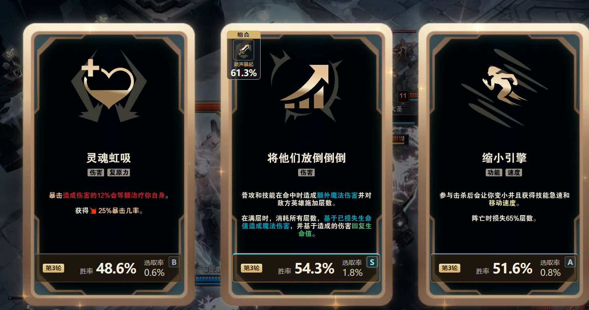
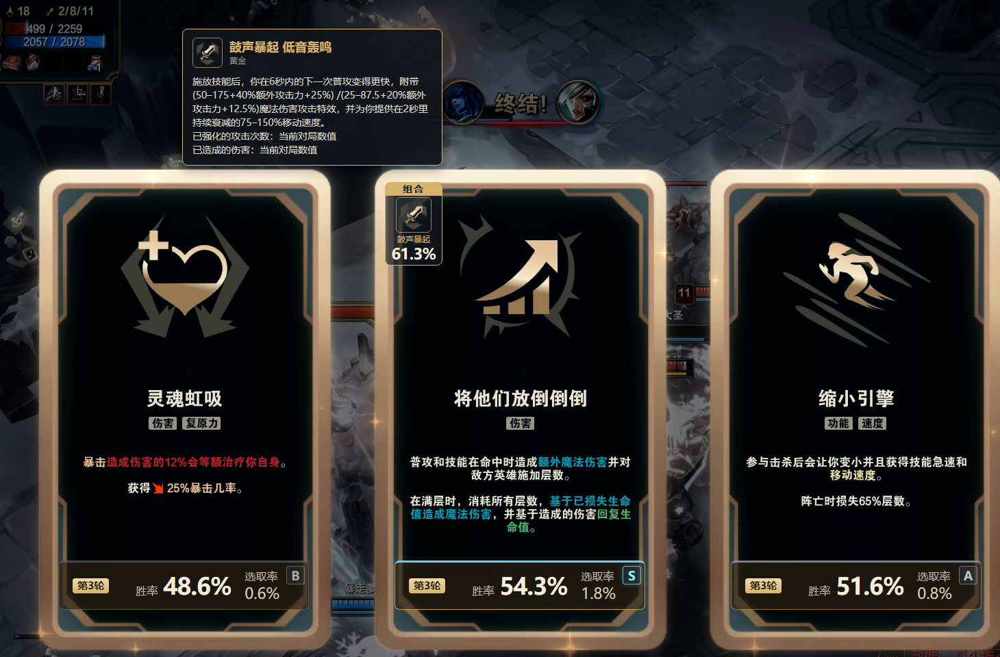
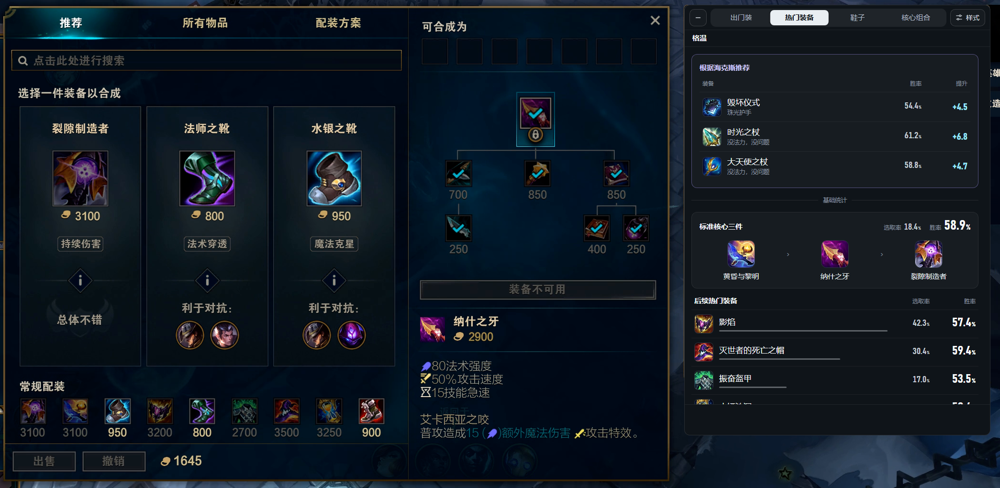
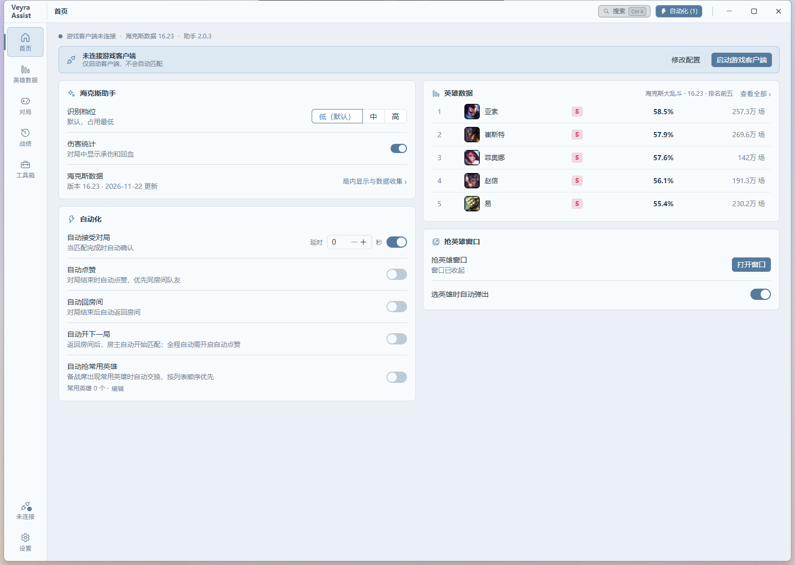
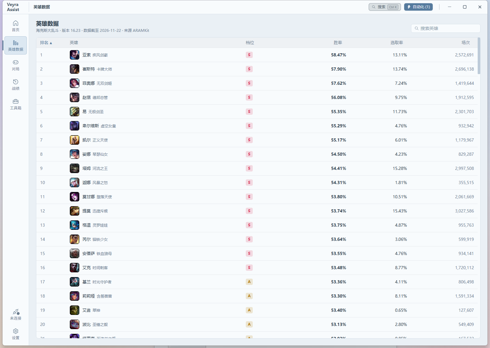
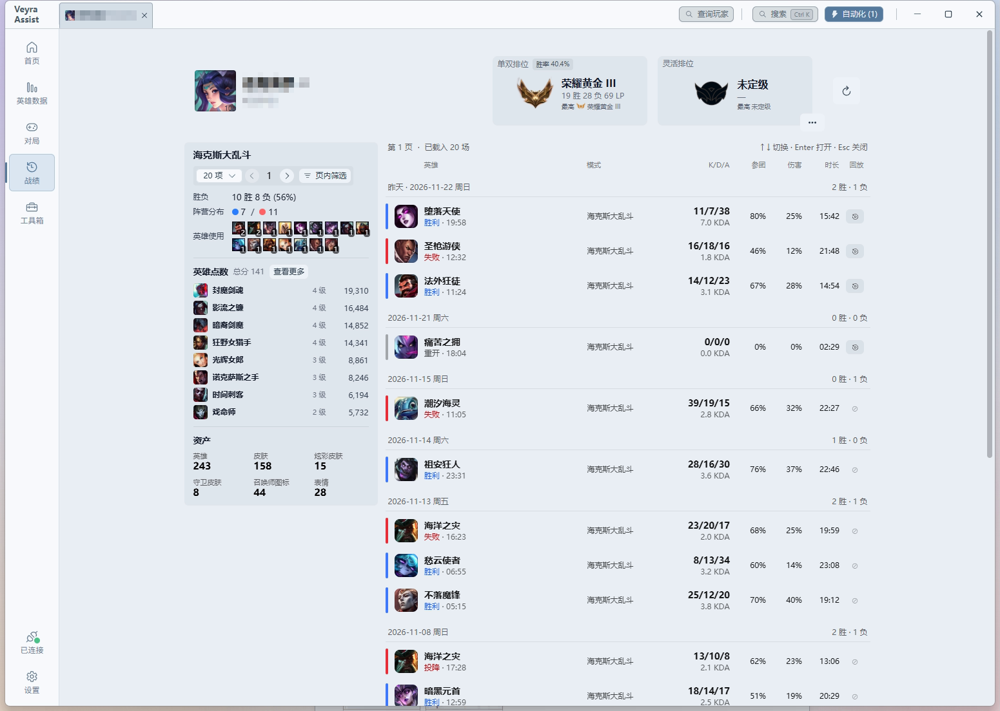
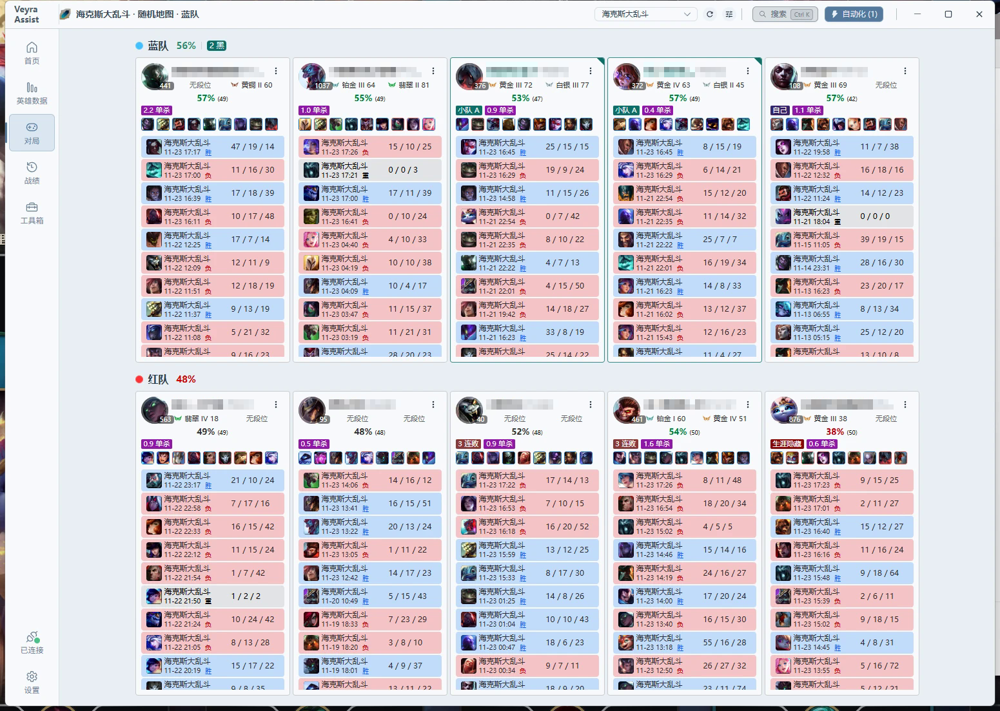
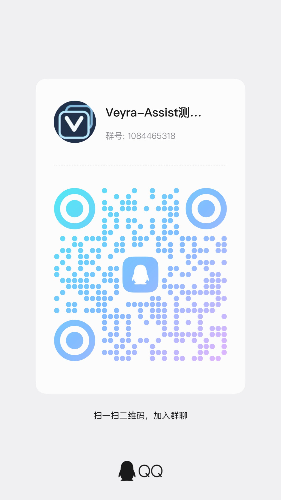

# Veyra Assist

一款专为海克斯大乱斗打造的辅助工具，基于 [League Akari](https://github.com/LeagueAkari/LeagueAkari) 二次开发。支持海克斯分轮次评分、基于已选海克斯的组合与出装联动推荐，同时集成英雄数据、战绩查询、对局分析及对局自动化功能。

**[前往 Releases 下载最新版本](https://github.com/Aevrilen/veyra-assist/releases/latest)** · `Windows x64` · 当前最新 `v2.0.3`

> 下载 Releases 中任意版本的 `Setup` 安装包完成安装后，启动程序即可自动更新至最新版本。

---

## 核心功能

### 分轮次海克斯评分

在海克斯三选一（或四选一）阶段，每张卡片下方实时展示当前轮次的胜率、选取率与评级（`S` / `A` / `B` / `C`），随轮次自动切换对应阶段数据。全面兼容新增海克斯、带边光特效的卡面、四选一赛季之星及质变类海克斯；识别引擎提供低、中、高三档配置，默认启用低档以保持最低系统资源占用。

### 已选海克斯组合推荐

工具自动识别并记录每轮已选海克斯，无需手动录入。当候选卡可与已选海克斯构成高胜率搭配时，卡片左上角将浮现组合标识，直观展示搭档海克斯的图标、简称与组合胜率。

将鼠标悬停于组合标识上，即可在卡片上方即时查阅搭档海克斯的完整名称与效果说明。

### 定向装备推荐

开启游戏内商店时自动呈现装备推荐面板，划分为「出门装」「热门装备」「鞋子」「核心组合」四个页签。其中「热门装备」顶部的「根据海克斯推荐」模块会结合已选海克斯，列出搭配胜率更高的装备清单及对应胜率、提升幅度。面板默认停靠于屏幕右侧，支持按住 `Ctrl` 键以左键拖拽至任意位置并自动记忆布局。

### 焕新首页

高频功能开关集中排布于首页，包含识别档位、伤害统计、自动化配置及抢英雄窗口，一目了然、即开即用。

### 英雄数据

收录全英雄在海克斯大乱斗模式下的排名、档位、胜率、选取率与场次，支持按名称检索及按列排序。进入英雄详情页后，可进一步查看各海克斯胜率（支持按稀有度、轮次筛选）与高胜率海克斯组合。数据来源于 ARAMKit，随版本同步更新。

### 战绩查询与对局分析

支持查询本人及其他玩家的近期战绩；对局页面同步展示双方全体玩家的近期战绩表现，便于赛前快速洞察局势。

### 其他功能

- **伤害统计面板**：对局内实时展示自身承伤与回血数据。
- **局内窗口快捷键**：支持为评分条、装备推荐及伤害统计面板独立绑定快捷键，一键切换显示与隐藏（需以管理员身份运行助手）。
- **对局自动化**：集成自动接受对局、自动点赞、自动回房间、自动开下一局及常用英雄自动抢选功能。
- **抢英雄窗口**：海克斯大乱斗选英雄阶段的便捷辅助小窗。
- **外观自定义**：内置多套主题配色，支持选取本地图片作为主窗口背景。

---

## 安装与使用

1. 前往 [Releases](https://github.com/Aevrilen/veyra-assist/releases/latest) 下载 `Setup` 安装包并完成安装。
2. 启动 Veyra Assist 后打开游戏客户端，程序将自动建立连接。
3. 请将游戏窗口模式设置为**无边框**（全屏模式下无法显示局内评分浮层，排海克斯大乱斗选英雄时助手亦会主动提示）。

> 当前仅支持 **Windows x64** 平台。

---

## 问题反馈

如在使用中遇到异常，请依次进入 **设置 → 帮助与反馈 → 导出反馈 ZIP** 保存诊断包，自行核查内容无误后私信发送给维护者（程序不会自动上传任何本地数据）。

提交公开 Issue 时，请附带以下信息以加快排查：
- 当前版本号与问题现象
- 具体复现步骤
- 屏幕分辨率与系统缩放比例

> 请勿在公开 Issue 中直接粘贴原始日志、完整配置文件或未经脱敏处理的截图。

---

## 交流群

QQ 交流群：**1084465318**

---

## 源码说明

本仓库仅公开**早期版本源码**（截至 `1.5.2-beta.3` 及 `2026-10-24` 公开增量），不包含后续迭代代码；Releases 中发布的当前版本源码暂不公开。

- 公开代码范围详见 [开源边界](docs/SOURCE_BOUNDARY.md)
- 本地开发与构建指引详见 [开发说明](docs/DEVELOPMENT.md)

---

## 许可与致谢

本项目完整保留 League Akari 的 [MIT LICENSE](LICENSE) 及原作者 Hanxven 的版权声明，同时保留适用的 ISC、OFL、Apache 等第三方开源许可与原始归属，详见 [THIRD_PARTY_NOTICES.md](THIRD_PARTY_NOTICES.md)。

**免责声明**：本项目与 Riot Games、腾讯、League Akari 上游项目及第三方数据提供方均无官方合作或认可关系。文中涉及的游戏名称、商标及相关资源均归各自权利人所有。
