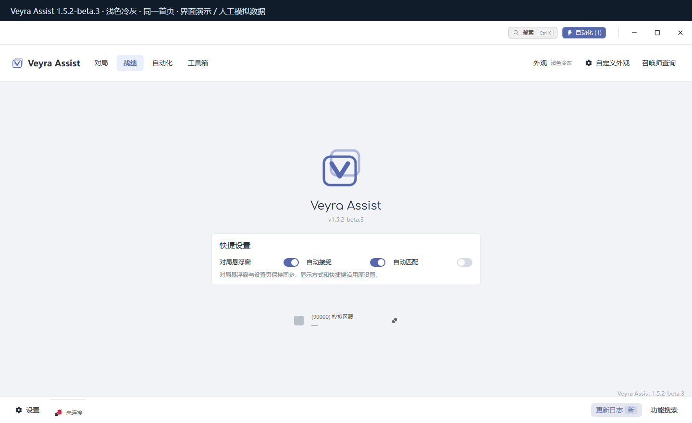
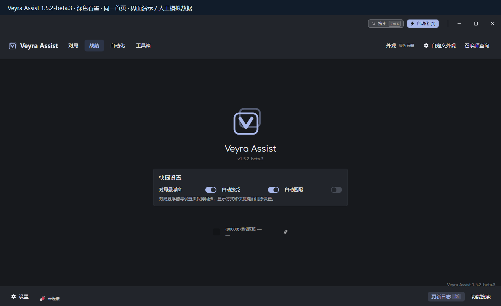
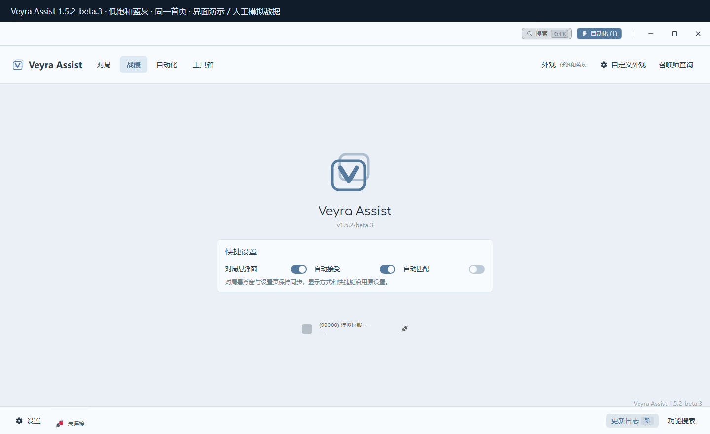
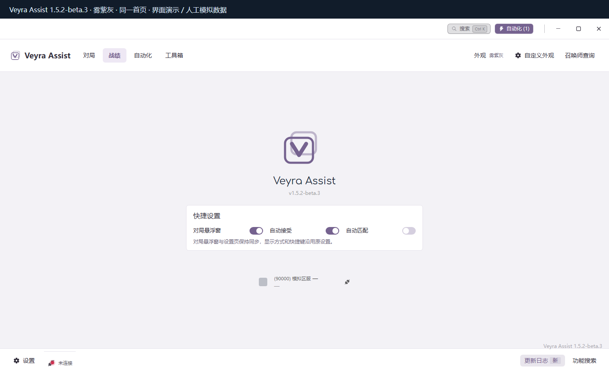
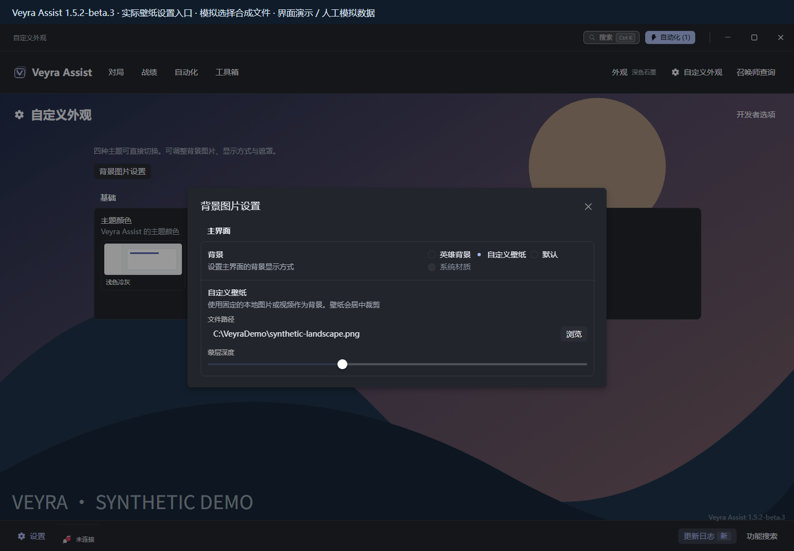
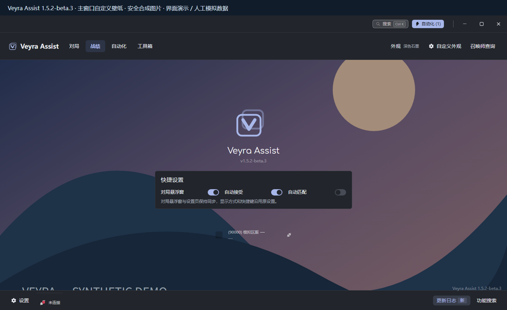
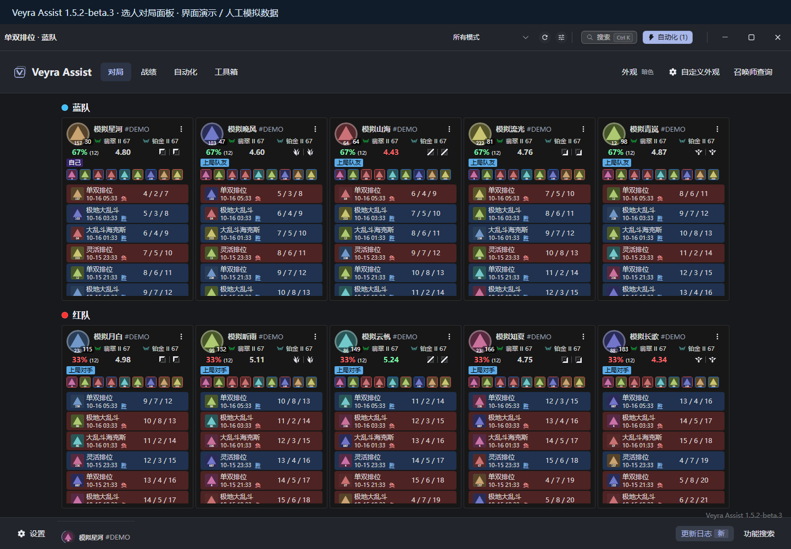
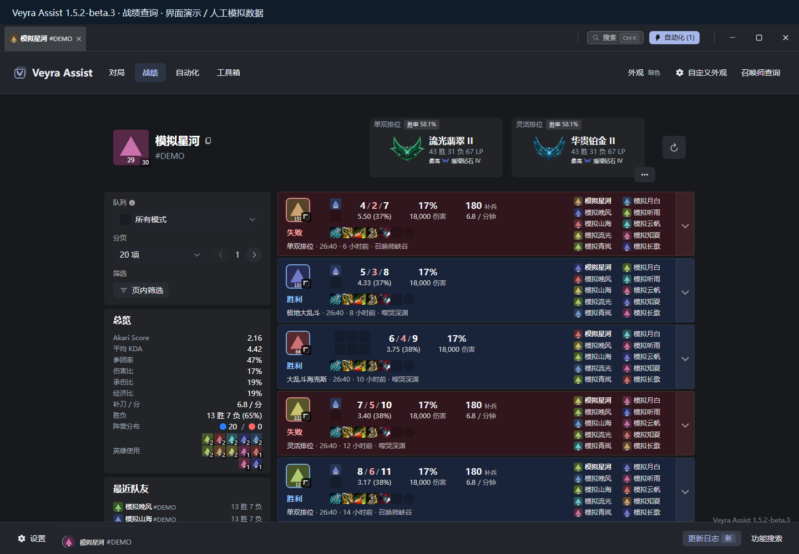

# Veyra Assist

基于 [League Akari](https://github.com/LeagueAkari/LeagueAkari) 二次开发的《英雄联盟》桌面辅助工具，提供选人辅助、局内海克斯识别与装备推荐，以及战绩查询和自动化功能。

> **开发中 / 半成品 · 测试版。** 当前提供 Windows x64 预发布。

> **部分开源**：2026-10-24 已同步经白名单审查的战绩 UI、通用快捷设置与测试，提供可运行的模拟结果接口；当前识别重构实现保留私有。默认分支保留旧公开基线及其许可，不代表最新完整程序源码。范围、历史公开限制和运行示例见 [开源边界](docs/SOURCE_BOUNDARY.md) 与 [导出清单](public-export.json)。本次没有更新 Release 或程序附件。

**[下载 1.5.2-beta.3](https://github.com/Aevrilen/veyra-assist/releases/tag/v1.5.2-beta.3)** · [开始使用](docs/USAGE.md) · [功能索引](docs/FEATURES.md) · [路线图 / Todo](docs/ROADMAP.md)

下载 Release **Assets 中的 `VeyraAssist-1.5.2-beta.3-0e54d71f-Windows-x64.zip`**，完整解压后运行 `启动Veyra.cmd`。GitHub 自动生成的 Source code 是源码，不能直接运行。

本页介绍已发布的 **beta.3**；对应源码见 [v1.5.2-beta.3 / 944f67f](https://github.com/Aevrilen/veyra-assist/tree/v1.5.2-beta.3)。默认分支保留原有开发基线，文档更新不代表程序源码已同步升级。详细变化和验证范围见 [本版说明](https://github.com/Aevrilen/veyra-assist/blob/v1.5.2-beta.3/docs/releases/1.5.2-beta.3.md)。

## 给使用者

### 当前功能

| 场景         | 已发布功能                                                             |
| ------------ | ---------------------------------------------------------------------- |
| 首页         | 对局悬浮窗、自动接受、自动匹配三个快捷开关，与设置页同步保存           |
| 选人         | 支持布局中的自动定位、候选英雄胜率与登场率、队友近期战绩及当前英雄统计 |
| 局内         | 海克斯标题本地 OCR 与统计浮层；热门装备、鞋子、核心组合和出门装推荐    |
| 对局与战绩   | 双方对局面板、召唤师查询、战绩筛选与详情，包括符文、构建和时间线       |
| 自动化与工具 | 自动接受和匹配、选禁英雄及英雄配置；功能搜索、内置离线更新日志         |
| Debug 反馈   | 帮助与修复中的日志目录和反馈 ZIP 导出，由用户检查后私下提交            |

自动接受缺省开启，已有明确关闭设置保留；自动匹配缺省关闭。**对局悬浮窗**沿用原显示方式和快捷键，旧 **Mini 白框弹窗**已停用。功能入口、适用范围和来源见 [功能索引](docs/FEATURES.md)。

**外观自定义**：提供浅色冷灰、深色石墨、低饱和蓝灰、雾紫灰四套快捷配色；可在“自定义外观 → 背景图片设置 → 自定义壁纸 → 浏览”选择本地图片作为主窗口背景，并调整蒙层深度。程序保存图片路径和设置，请保留原文件。操作见 [使用说明](docs/USAGE.md#外观与图片导入)。

### 界面预览

以下为 beta.3 对应实际渲染组件的**界面演示**，玩家 ID、战绩和统计均为人工模拟。局内图组合展示原浮层。图片来源与组件核对见 [预览说明](docs/PREVIEWS.md)。

**主页快捷开关**：常用设置集中在首页，右下角可查看本地更新日志。

**四套配色，同一首页**：点击图片可查看完整尺寸。

| 浅色冷灰                                                                                         | 深色石墨                                                                                       |
| ------------------------------------------------------------------------------------------------ | ---------------------------------------------------------------------------------------------- |
|        |   |
| **低饱和蓝灰**                                                                                   | **雾紫灰**                                                                                     |
|  |  |

**本地图片导入**：实际背景图片设置入口，以及安全合成壁纸在主窗口的应用效果。演示仅模拟文件选择与本地资源读取，保留原设置和背景渲染组件。

**选人辅助**：对局面板汇总双方玩家的近期表现；支持的选人布局可自动定位统计浮层。

**局内海克斯与装备**：海克斯统计条与装备推荐面板，可切换装备分类并收起面板。

**战绩面板**：查看历史对局、队列筛选与玩家统计，展开对局可继续查看详细数据。

### 安装与使用

1. 下载当前 [beta.3 程序 ZIP 和随包说明](https://github.com/Aevrilen/veyra-assist/releases/tag/v1.5.2-beta.3)，退出旧实例，完整解压到新的、较短目录。
2. 运行 `启动Veyra.cmd`，登录游戏客户端，确认连接状态，在首页按需设置快捷开关。
3. 进入选人或支持的局内场景后使用辅助界面；选人自动定位时保持客户端前台、窗口稳定。

当前面向 **Windows x64**。局内自动窗口映射覆盖 1920×1080 和 2560×1440、窗口完整落在单个显示器内的场景；4K 与不同缩放比例适配仍在评估。macOS 尚无 Veyra 功能验收，Linux 暂无支持承诺。更多说明见 [使用说明](docs/USAGE.md)。

### 路线图 / Todo

产品方向清单，编号不代表优先级，均为待完善或待实现：

1. 优化识别方案与硬件适配，提供高、低性能两档。
2. 对比备选英雄与已选英雄的胜率，辅助选择推荐。
3. 海克斯与装备特殊组合的算法推荐。
4. 自定义装备构筑导入。
5. UI 美术优化／重做，完善信息层级、模块布局和视觉一致性，保留原交互。
6. 有充分数据支持的评分系统。
7. 完善识别流程的全自动化。
8. 新增统一一键显示／隐藏快捷键。

先推进识别稳定性、性能档与 4K / DPI 适配，再完善自动化和快捷操作，随后是 UI 与构筑导入、英雄与特殊组合推荐，数据评分最后。beta.3 的选人自动定位已发布，不能据此将整体自动化目标勾为完成；近期继续整合已离线验证的 OCR、缓存迁移和启动修复。应用内自动更新与差分下载暂缓，当前继续手动发包和 GitHub Releases。

后续公开版本将同步更新仓库主页、功能状态、预览和包内说明。完整进度见 [路线图](docs/ROADMAP.md)。

### 配置、日志和反馈

遇到问题，在 **设置 → 帮助与修复 → 导出反馈 ZIP** 选择保存位置。先检查内容，再私下发给维护者；程序不会自动上传。公开 Issue 请附版本、现象、复现步骤、分辨率和缩放，避免发送原始日志、完整配置或未脱敏截图。详见 [Debug 反馈](docs/USAGE.md#debug-反馈) 与 [隐私说明](docs/PRIVACY.md)。

### 当前交流群

当前QQ群：**1084465318**。这是现阶段的临时交流群；新版推出后可能更换。入群不代表获得最终新版测试名额。

二维码由项目维护者提供，保留原图。过期时可尝试群号；后续群信息集中在本节更新。

## 给开发者

技术栈包括 TypeScript、Electron、Vue 3、Pinia、MobX、Naive UI、Tailwind CSS、TypeORM / SQLite；Windows 原生扩展使用 C++ / Node-API。准确版本以所选源码版本的 `package.json` 和 `yarn.lock` 为准。

- [开发与构建](docs/DEVELOPMENT.md)：源码依赖、构建入口和本地 OCR 环境；公开源码未附全部外部预编译运行依赖。
- [架构与数据流程](docs/ARCHITECTURE.md)：主进程、渲染窗口、LCU 和数据源。
- [外部依赖校验清单](docs/EXTERNAL_DEPENDENCIES.json) · [公开整理差异](docs/EXPORT_DIFFERENCES.md)。
- [已发布 beta.3 源码](https://github.com/Aevrilen/veyra-assist/tree/v1.5.2-beta.3) · [本版来源与验证](https://github.com/Aevrilen/veyra-assist/blob/v1.5.2-beta.3/docs/releases/1.5.2-beta.3.md)。

欢迎提交问题和 Pull Request。请说明复现条件、改动范围及实际运行的检查；新测试使用合成输入，不提交真实账号标识或个人对局数据。

### 许可与致谢

保留 Akari 的 [MIT LICENSE](LICENSE) 及原作者 Hanxven 的版权声明，另保留适用的 ISC、OFL、Apache 等许可与真实归属。文件级来源、素材归属和公开整理记录见 [THIRD_PARTY_NOTICES.md](THIRD_PARTY_NOTICES.md)。版权许可与商标使用分别说明。

本项目与 Riot Games、腾讯、Akari 上游及第三方数据提供方无官方合作或认可关系。游戏名称、商标和相关资源归各权利人所有；不承诺游戏更新、反作弊或平台规则兼容性。
