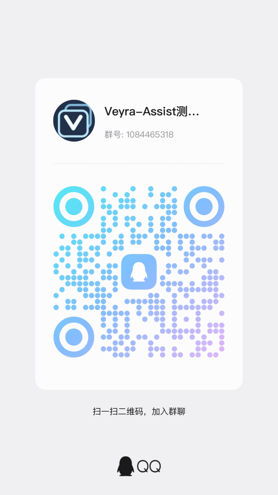

# Veyra Assist

> **本发布分支：Mini 白框修正版 `1.5.2-beta.2-mini-fix.20261015`。** 停用旧 Mini 窗口及入口，其倒计时和临时取消／拒绝按钮随之移除；自动接受、自动匹配核心及主窗口设置保留。284 项聚焦离线测试、类型检查和生产构建通过，尚未运行本版 GUI 或真实游戏实测。详情见[本版说明](docs/releases/mini-fix-5abfbe3c.md)。

> **开发中 / 半成品 · 测试版。** 尚未完成跨电脑和真实游戏环境验收。本源码未附外部预编译运行依赖，缺少这些文件时不能直接完成应用构建。

> **程序下载入口：[GitHub Releases](https://github.com/Aevrilen/veyra-assist/releases)。** 普通用户应下载 Release 的 **Assets 中标有 `VeyraAssist` 的程序 ZIP**，不要下载 GitHub 自动生成的 **Source code (zip / tar.gz)**；后者是源码，不能直接运行。当前日志优化修订版为 **1.5.2-beta.2 / Windows x64 预发布**，请阅读该版验证范围和限制。

Veyra Assist 是基于 [League Akari](https://github.com/LeagueAkari/LeagueAkari) 二次开发的《英雄联盟》桌面辅助工具，当前重点是选人辅助、海克斯识别与装备推荐。项目沿用 Akari 的 Electron、Vue、LCU 连接、模块框架和部分界面，并在此基础上扩展功能。上游作者和代码来源见 [许可与致谢](THIRD_PARTY_NOTICES.md)。

此快照以 `37e2ccc` 为源码基线，公开整理差异见 [导出说明](docs/EXPORT_DIFFERENCES.md)。1.5.2-beta.2 保留日志反馈增量，从公开源码重建应用并替换旧资源；范围、来源和限制见 [修订版说明](docs/releases/1.5.2-beta.2-log-feedback.md)。

## 给使用者

### 当前状态

| 功能           | 已掌握的验证范围       | 当前限制                                              |
| -------------- | ---------------------- | ----------------------------------------------------- |
| 初版选人辅助   | 开发者本机实测         | 未覆盖其他电脑、客户端版本、缩放和区服                |
| 初版海克斯识别 | 开发者本机实测         | 依赖画面、中文标题、本地 OCR 和正确定位；可能识别失败 |
| 初版装备推荐   | 开发者本机实测         | 数据源和版本可能变化，结果仅供参考                    |
| 新版自动定位   | 开发中，未达到可用验收 | 后续版本在验收前默认关闭，不列为已完成功能            |
| 日志反馈 ZIP   | 源码已同步，离线验证   | 保存对话框、打开目录及完整应用启动尚未实机验收        |

初版实测范围有限。源码中仍有自动定位原型与旧通知代码，相关新版能力的验收状态见 [路线图](docs/ROADMAP.md)。

### 安装与使用

程序包统一通过 [Releases](https://github.com/Aevrilen/veyra-assist/releases) 提供；仅下载其中明确列出的程序 ZIP，并先阅读该版已知限制。尚无正式稳定版或完整安装向导。解压到新目录，在非游戏期间退出旧版后使用包内启动脚本；不要覆盖运行中的文件。需要回退时退出测试版，再从旧目录启动。能够自行配置开发环境的读者可阅读 [开发与构建](docs/DEVELOPMENT.md)。

已有开发版的使用流程是：启动并登录游戏客户端，运行应用，检查连接状态和环境诊断，再使用对应的选人或游戏内辅助界面。首次使用可能需要按界面校准位置。游戏未在前台、窗口尺寸不支持、OCR 模型缺失或接口返回异常时，辅助信息可能暂停或不显示。当前源码快照需要先按开发文档准备依赖。

实机截图待补充，公开前会去除个人信息。

### 已知问题和环境限制

- 跨局缓存问题已有离线修复工作，尚未纳入此基线并完成实机复测。
- UI 调整、通知日志修复和通知入口清理仍待整合与回归；当前可能看到继承自 Akari 的名称、入口或链接。
- 新版优先推进自动定位、已知 bug 和原版冗余通知入口清理。一键拉起游戏的配置问题暂缓，根因尚未确认。
- 当前功能重点面向 **Windows x64**。选人窗口几何与游戏窗口识别依赖 Win32 原生接口；部分能力受权限等级影响。macOS 保留上游代码和构建入口，Veyra 功能未在该平台验收。Linux 不在当前支持承诺内。
- 当前自动定位原型的游戏窗口映射限制为 1920×1080 或 2560×1440、窗口完整落在单个显示器内。手动旧流程还有更窄的截图尺寸要求。不同 DPI、多屏、遮挡、切屏、游戏更新均需单独验证。
- 本地 OCR 会占用 CPU。没有经过验证的最低 CPU、内存或显卡规格；不承诺特定帧率或识别准确率。RapidOCR 候选使用 CPU 推理，不要求 CUDA。
- LCU、Live Client、SGP 和外部统计接口会随版本与区服变化。区服、加速器和网络兼容性需实测，不承诺全区服支持。

详见 [路线图](docs/ROADMAP.md) 与 [架构和数据流程](docs/ARCHITECTURE.md)。

### 配置、日志和反馈

应用会在本地保存设置、缓存和日志。OCR 主流程在本地处理截图，统计、素材、远程配置及部分继承功能仍会联网；不能将整个应用描述为完全离线。数据位置和反馈注意事项见 [隐私与反馈](docs/PRIVACY.md)。

仓库开放后，可通过本仓库 Issues 提交复现步骤、应用版本、操作系统、分辨率、缩放和脱敏错误摘要。**不要在公开 Issue 或交流群发送原始日志、完整截图、用户数据库、客户端命令行或 token。** 敏感问题应先联系维护者约定私下接收方式，目前不提供未经核实的安全邮箱。

### 当前交流群

当前QQ群：**1084465318**。这是现阶段的临时交流群；新版推出后可能更换。入群不代表获得最终新版测试名额。



二维码由项目维护者提供，保留原图。过期时可尝试群号；后续群信息集中在本节更新。

## 给开发者

### 技术栈

TypeScript、Electron、Vue 3、Pinia、MobX、Naive UI、Tailwind CSS、electron-vite、TypeORM / SQLite、Winston；Windows 原生扩展使用 C++ / Node-API。本地 OCR 包含 Tesseract.js 及可选 RapidOCR CPU worker。准确版本以 `package.json` 和 `yarn.lock` 为准。

### 目录导航

```text
src/main/                 Electron 主进程、模块注册、平台能力和服务
src/preload/              主进程与渲染层之间的桥接
src/renderer/             主窗口、选人浮层、游戏内浮层及继承窗口
src/renderer-shared/      公共组件、renderer shards、状态和素材
src/shared/               类型、模块框架、API 适配器、规则和纯逻辑
native/win32-x64/         Windows 原生扩展源代码与 TypeScript 包装
resources/ocr/            本地 OCR worker、Tesseract 模型及模型许可
scripts/                  构建、裁剪、便携包和许可收集脚本
docs/                     架构、开发、路线图与隐私说明
third_party/              补充第三方许可证和来源记录
```

源码经过公开前清理，未包含旧 Git 历史、开发交接、原始实测数据和预编译应用。以下外部运行依赖未随仓提供，现有主进程仍会静态导入它们，因此缺失时完整构建会报错：

| 本地路径                                  | 固定官方来源                                                                                                                                                 |
| ----------------------------------------- | ------------------------------------------------------------------------------------------------------------------------------------------------------------ |
| `resources/elevate.exe`                   | [Akari 固定文件](https://raw.githubusercontent.com/LeagueAkari/LeagueAkari/5109b2f7fcce6e02312e534cd1729ed0f2142b51/resources/elevate.exe)                   |
| `resources/akari-updater.exe`             | [Akari 固定文件](https://raw.githubusercontent.com/LeagueAkari/LeagueAkari/5109b2f7fcce6e02312e534cd1729ed0f2142b51/resources/akari-updater.exe)             |
| `resources/magic/magic.win32-x64.node`    | [Akari 固定文件](https://raw.githubusercontent.com/LeagueAkari/LeagueAkari/5109b2f7fcce6e02312e534cd1729ed0f2142b51/resources/magic/magic.win32-x64.node)    |
| `resources/magic/magic.darwin-arm64.node` | [Akari 固定文件](https://raw.githubusercontent.com/LeagueAkari/LeagueAkari/5109b2f7fcce6e02312e534cd1729ed0f2142b51/resources/magic/magic.darwin-arm64.node) |

[校验清单](docs/EXTERNAL_DEPENDENCIES.json)记录了来源提交、Git blob、大小和 SHA-256；[开发与构建](docs/DEVELOPMENT.md)提供取得、校验和 OCR 环境说明。这些地址用于准备开发依赖。源码和外部二进制依赖分别按各自许可与归属处理。

### 参与贡献

欢迎提交问题和 Pull Request。请说明复现条件、改动范围和实际运行的检查；标清离线测试与实机测试的区别。新测试使用合成输入，不提交个人对局响应、截图或真实账号标识。涉及模块接口、跨进程状态或持久化格式时，先阅读 [架构](docs/ARCHITECTURE.md)。

### 许可与致谢

保留 Akari 的 [MIT LICENSE](LICENSE) 及原作者 Hanxven 的版权声明，另保留适用的 ISC、OFL、Apache 等许可与真实归属。文件级来源、素材归属和公开整理记录见 [THIRD_PARTY_NOTICES.md](THIRD_PARTY_NOTICES.md)。版权许可与商标使用分别说明。

本项目与 Riot Games、腾讯、Akari 上游及第三方数据提供方无官方合作或认可关系。游戏名称、商标和相关资源归各权利人所有；不承诺游戏更新、反作弊或平台规则兼容性。
