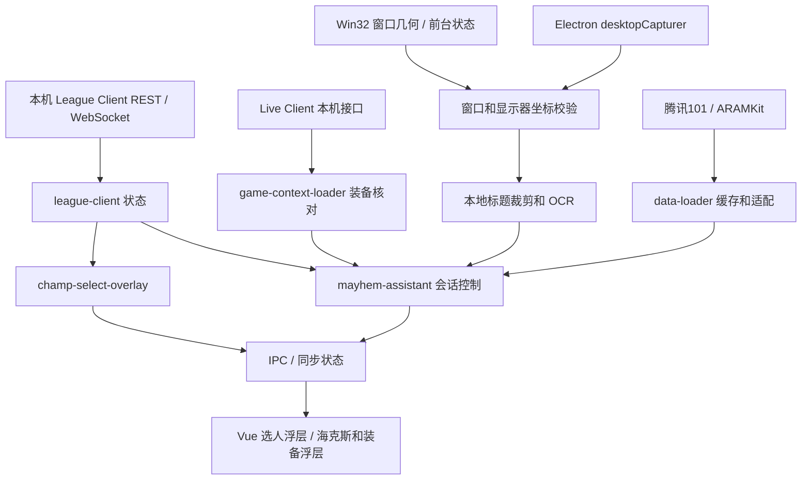

# 实现框架与数据流程

本文描述当前源码快照中实际存在的结构。离线代码检查和开发者本机实测分别记录；新版功能验收状态见 [路线图](ROADMAP.md)。

## 启动、模块和跨进程边界

入口为 `src/main/main.ts`，便携配置在 `src/main/portable.ts`，模块注册在 `src/main/bootstrap/index.ts`。应用使用 Akari 的 `src/shared/akari-shard/` 框架进行依赖注入和生命周期管理；主进程负责客户端连接、文件与数据库、网络、原生窗口能力和功能编排。

主进程模块用 `@Shard(...)` 标识，在 bootstrap 中注册。`index.ts` 通常负责依赖、状态与生命周期，内部 controller / loader / executor 分别承接流程、加载和执行。旧模块并不全部采用同一拆分形式。

渲染层使用 Vue、Pinia 和 renderer shards。`src/preload/` 暴露桥接接口，IPC 模块负责调用与事件；MobX 状态通过同步机制传到渲染层。渲染组件读取 store / props 并渲染界面，不直接持有 LCU 认证材料。

该图覆盖主要数据流，SGP、素材和上游配置还服务其他继承功能。

## 模块职责

| 路径                                            | 责任                                                            |
| ----------------------------------------------- | --------------------------------------------------------------- |
| `src/main/shards/league-client/`                | 本机 League Client 进程发现、认证、REST / WebSocket 与 LCU 状态 |
| `src/main/shards/game-client/`                  | 本机游戏客户端接口、窗口快照和前台信息                          |
| `src/main/shards/champ-select-overlay/`         | 选人窗口编排、位置校准、候选和队友浮层、候选操作及反馈          |
| `src/main/shards/ongoing-game/`                 | 进行中对局状态、成员和分析结果，向选人功能提供上下文            |
| `src/main/shards/mayhem-assistant/`             | 海克斯与装备辅助的会话、定位、截图、OCR、数据加载和窗口编排     |
| `src/shared/mayhem-assistant/`                  | 数据归一化、名称匹配、装备规则、会话模型和备用校准逻辑          |
| `src/main/shards/champion-data/`                | 英雄数据的请求、来源选择和服务控制                              |
| `src/main/shards/sgp/`                          | 基于客户端认证与配置的 SGP 请求；支持范围取决于接口和区服       |
| `src/main/shards/akari-api/`                    | 继承的远程配置、公告、联系入口和版本信息加载                    |
| `src/main/shards/storage/`、`setting-factory/`  | SQLite / TypeORM 存储和模块设置                                 |
| `src/main/native/`、`native/win32-x64/`         | 平台适配、输入和窗口 API 包装                                   |
| `src/renderer/src-champ-select-overlay-window/` | 选人浮层入口                                                    |
| `src/renderer/src-mayhem-overlay-window/`       | 游戏内辅助浮层入口                                              |

渲染构建实际还保留 main、aux、OP.GG、ongoing-game、CD timer 等入口；保留入口不代表该窗口仍是 Veyra 当前主流程或已验收功能。

## LCU 与选人辅助

`league-client` 获得本机客户端连接信息并维护 gameflow、champ-select、summoner 和 game-data 等状态。认证值由本机进程动态取得，不应写入源码或反馈材料。

`champ-select-overlay/index.ts` 将 LCU 会话、`ongoing-game` 数据、Win32 窗口快照、位置校准和 IPC 连接起来。原生快照提供物理坐标，Electron `screen.screenToDipRect` 等负责转到窗口使用的 DIP 坐标。候选按钮操作还需要匹配当前会话、目标窗口及调用方身份，相关逻辑见 `candidate-grab-controller.ts` 和 IPC handlers。

## 游戏窗口、截图与定位

`mayhem-assistant/overlay-controller.ts` 调度截图、会话和识别。`game-client` 的窗口快照用于核对进程、窗口边界、可见性、最小化与前台状态；Electron `desktopCapturer` 提供显示器画面。截图来源和物理像素坐标匹配后再裁剪游戏区域及标题。

`game-frame-layout.ts` 明确限制自动原型只映射 1920×1080、2560×1440 的 16:9 客户区，且游戏窗口要完整处于一个显示器中。显示器原点和 DPI 需经过转换，不能用 CSS 像素直接截取物理画面。旧手动路径存在 2560×1440 的额外限制。

`game-ui-locator.ts` 通过边缘探针和卡片几何进行跟踪、搜索，设置时间预算并拒绝歧义；`shop-locator.ts` 与备用校准控制器参与商店和备用定位。`tooltip-occlusion.ts` 检查遮挡。定位失败、画面不合适或识别尚未完成时，控制器可能暂停或隐藏浮层。

**基线差异：** 此导出的旧原型会在未启用手动校准时进入自动路径。用户要求的新版自动定位仍在继续开发，后续验收前默认关闭；该新版开关策略不属于本次冻结源码。不能把原型入口或离线检查写成新版自动定位已可用。

## OCR 与识别结果

`ocr-executor.ts` 按 `AKARI_MAYHEM_OCR_BACKEND` 选择后端。普通开发路径默认 Tesseract.js，显式读取本地 `chi_sim.traineddata`，不采用默认在线模型地址；worker 对裁剪标题做单行识别。`resources/ocr/SOURCE.json` 记录了模型来源、整数化转换和校验值。

RapidOCR CPU 候选使用 `rapidocr-executor.ts` 启动独立 Python worker，通过标准输入输出传递请求。Python 以 `-I -B -u` 启动，worker 与模型均来自本地路径；缺少所选后端资源时会失败，不静默切换后端。便携入口会默认选择 RapidOCR，因此便携包需要额外准备 Python、依赖和 ONNX 模型。

名称匹配、拒绝原因、标题与帧变化、会话和布局版本共同决定是否显示识别结果。`37e2ccc` 中的 RapidOCR 超时恢复代码存在于此基线，不能据此宣称已完成全部跨局缓存和长期稳定性修复。

## 数据源、装备与渲染

`mayhem-assistant/data-loader.ts` 的实际来源如下：

| 内容                 | 源码请求目标                                                       | 用途                                      |
| -------------------- | ------------------------------------------------------------------ | ----------------------------------------- |
| 装备统计             | `mlol.qt.qq.com/go/battle_info/odp_proxy/fuwen_hero_rank`          | 依据 champion ID 拉取腾讯101统计并归一化  |
| 海克斯统计           | `data.aramkit.cn/data/versions.json` 及版本对应的 champion-details | 按版本、日期和英雄加载 ARAMKit 全阶段数据 |
| 已有装备             | 本机 Live Client player list / game stats                          | 核对玩家、英雄和 KIWI 模式后读取背包      |
| 英雄、物品和资源素材 | `extra-assets`、LCU 及继承的素材适配器                             | 名称、图标和游戏数据                      |

统计缓存校验 schema、英雄、来源、保存时间及数据日期；当前实现将缓存获取年龄限制在一天内、统计日期限制在七天内。缓存是失效回退的一部分，不能保证离线时一定有可用数据。

`game-context-loader.ts` 对 Live Client 返回的身份、英雄和模式进行核对，并给背包结果设置有效时间。装备规则和起始装备偏好位于 `src/shared/mayhem-assistant/equipment-rules.ts` 与 `starting-equipment/`。控制器生成快照，窗口控制器通过 IPC 更新渲染视图。

SGP 是另一条继承数据路径，依赖远程 server 配置、token 类型、目标接口、区服兼容性和网络条件。不能从 token 存在或共享地址推断跨区查询可用。

## 仍需复核的边界

Veyra 的 `self-update/platform.ts` 已将自动更新生命周期和应用更新禁用，防止安装上游 Akari 发行包；部分旧测试尚未适配该策略。继承的公告、联系入口、统计上报和外部链接仍待独立化审查，不能据更新禁用推断所有继承网络行为都已移除。网络端点见相应 API helpers 与 `akari-api`、`statistics` 模块。原生 `magic` 二进制没有对应源码随此基线提供，清理后完整构建受阻。公开前需处理这些依赖以及 [许可核验项](../THIRD_PARTY_NOTICES.md)。
