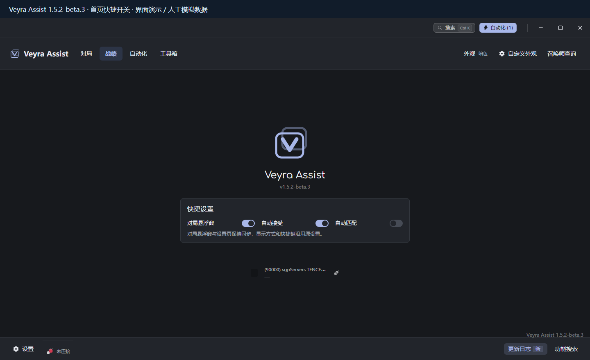
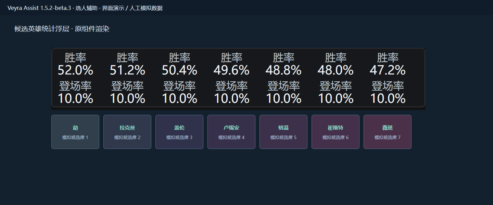
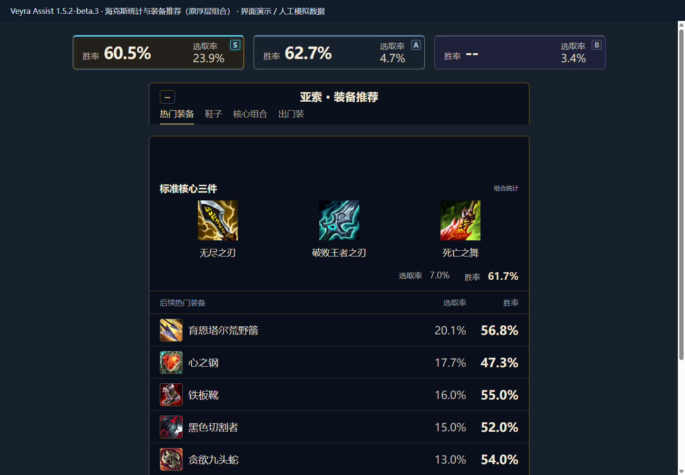

# 界面预览与来源

预览取自已审核的 beta.3 隔离模拟 UI，源代码映射为 `944f67f62e13f437a322de133d01c021d3dc983c`，对应原始构建 `0e54d71f8f1e21f4caad7c257a0e0c2db26762d9`。以实际 Vue 组件渲染，IPC、客户端响应、玩家、战绩及统计由离线适配器提供人工模拟值。

所有图片直接标注“界面演示 / 人工模拟数据”。图片没有使用私人截图、录屏、用户日志或配置，也没有采用 AI 概念图。仅展示界面与交互布局，不能用于证明真实游戏中的 OCR 准确率、胜率或性能。

| 预览                                                     | 内容                                 | 渲染方式                                                                      |
| -------------------------------------------------------- | ------------------------------------ | ----------------------------------------------------------------------------- |
| [首页](../assets/previews/home.png)                      | 三个快捷开关、更新日志入口           | 实际 StartupPane 与主窗口；接受开启、匹配关闭为演示设置                       |
| [选人对局面板](../assets/previews/champ-select.png)      | 双方玩家近期战绩与汇总               | 原主窗口对局视图，全部昵称带“模拟”及 `#DEMO`                                  |
| [候选统计浮层](../assets/previews/candidate-overlay.png) | 候选英雄胜率和登场率                 | 原 ChampSelectOverlay 统计组件；下方名称与候选席为人工背景，放大方便阅读      |
| [局内辅助](../assets/previews/in-game.png)               | 三张海克斯统计条、装备分类与核心装备 | 原 AugmentBar、EquipmentControls、EquipmentPanel 等浮层组合；没有真实游戏背景 |
| [战绩](../assets/previews/match-history.png)             | 模拟玩家历史战绩、队列与筛选         | 实际战绩页面，图标素材及第三方归属沿用项目许可                                |

本轮只更新文档和展示资产。没有修改实际发布的 ZIP、EXE、ASAR、Release 附件或标签。下一公开整合版应重新核对源码及界面后更新图片。

功能依据见 [功能索引](FEATURES.md)，数据与素材归属见 [THIRD_PARTY_NOTICES.md](../THIRD_PARTY_NOTICES.md)。
